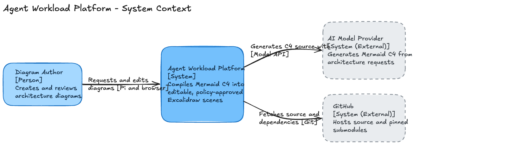

# Agent Workload Platform

This monorepo lets an agent running on a client machine orchestrate products
across local tools, capability-limited WebAssembly modules, isolated Gondolin
micro-VMs, browsers, storage systems, and remote model infrastructure.

C4-to-Excalidraw is the first workload, not the scope of the platform.
Its browserless Wasm path is tested with context, container, component,
dynamic, and deployment views. Wassette loads one composed `c4-suite.wasm`;
WAC assembles that suite from immutable, independently reusable components.

The Gondolin browser extension runs the maintained MCP Memory Server beside
Playwright so Pi can recall earlier research and retain durable browser
findings across sessions without a platform-owned persistence implementation.
When `GITHUB_TOKEN` is present, it also loads the published GitHub Wassette
component by pinned OCI digest—without rebuilding it.

_C1 system context rendered from the policy-approved Excalidraw scene._

## C4 workload

C4-to-Excalidraw is the first platform workload. Follow the [C4 workload
README](workloads/c4-excalidraw/README.md) for setup, build, verification, and
the real Pi dog-food run, including supported syntax and rendering limits.

## k3s Earendil runtime

The development-agent runtime can run as a hardened Pi workload beside a
separately confined Wassette deployment in k3s. Pi retains the model loop but
starts without its local shell and filesystem tools; its only workload tools
come from Wassette. See [the k3s Earendil runtime](runtimes/k3s-earendil/README.md)
for image construction, credential provisioning, deployment, and boundary
verification.

## Voice agent product

The [voice agent product](products/voice-agent/README.md) provides
a private browser voice assistant for Apple Silicon. MLX Whisper, Ollama, and
Kokoro stay on macOS behind a narrow authenticated inference broker, while the
browser-facing Pipecat application, task gateway, storage, observability, and
tailnet ingress run under Docker Compose. See its
[host requirements](products/voice-agent/HOST_REQUIREMENTS.md) for the
security boundary, exact prerequisites, and repeatable lifecycle checks.

The source-controlled architecture views are:

- [C1 system context](workloads/c4-excalidraw/examples/c1-system-context.mmd)
- [C2 container view](workloads/c4-excalidraw/examples/c2-container.mmd)
- [C3 Pi extension components](workloads/c4-excalidraw/examples/c3-pi-extension-components.mmd)

## Layout

- `products/` — user-facing vertical slices. Each product owns its applications,
  services, workers, deployment profiles, tests, documentation, and vocabulary.
  - `voice-agent` — tailnet-only browser voice with host MLX inference and
    Gondolin-isolated Pi tools.
- `apps/` — reusable runnable applications, including the pinned `excalidraw-mcp` submodule.
- `workloads/` — independently runnable agent workloads, including `c4-excalidraw`.
- `adapters/` — implementations at external seams:
  - `mermaid-to-excalidraw` — untouched upstream submodule.
  - `c4-gondolin` — platform-owned C4/browser adapter.
- `components/` — reusable WIT/WebAssembly modules.
- `runtimes/` — Pi, Wassette, and Gondolin runtime integration.
  - `gondolin-browser` — Pi extension that exposes the official Playwright MCP
    tools from an isolated VM alongside persistent memory and optional GitHub
    tools in Wassette, without copying their schemas.

Product-specific contracts, prompts, examples, and modules remain inside the
product until another product genuinely reuses them. Shared implementations
then move to `components/`, `adapters/`, `apps/`, or `runtimes/` according to
their responsibility.

The repository is migrating from technical top-level buckets to product and
bounded-context ownership. See [Monorepo organization](docs/monorepo-organization.md)
for the target structure and remaining moves.

There is no repository-specific dispatcher or lifecycle wrapper. A single pnpm
workspace installs and runs every JavaScript package. Upstream lockfiles remain
inside untouched Git submodules for provenance but are not used by the platform
workflow. See the C4 package README for dependency setup. Imported source
provenance is recorded in `PROVENANCE.md`.

## Research

- [Available Wasm components and ecosystem compatibility](docs/research/available-wasm-components-ecosystem.md)
- [WIT and TypeScript component practices](docs/research/wasm-wit-typescript-best-practices.md)
