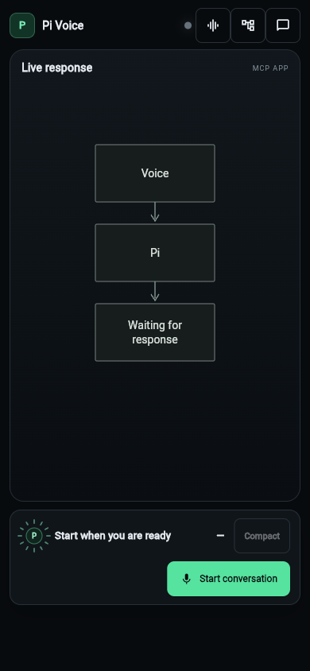
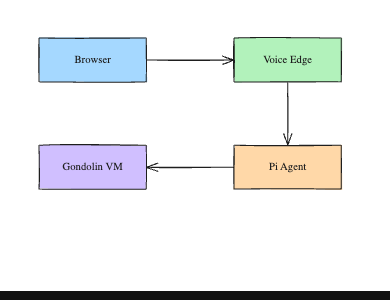
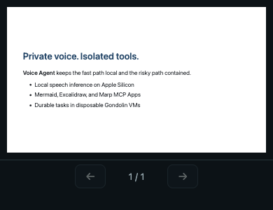

# Agent Workload Platform

A private runtime for conversational agents that can safely use tools and hand
off long-running work.

The first product is [Voice Agent](products/voice-agent/README.md): a
tailnet-only browser assistant for Apple Silicon. It supports live voice and
typed conversations, renders Mermaid, Excalidraw, and Marp MCP Apps, and can
delegate durable coding tasks without giving the browser or voice container
direct access to host credentials or files.



The same response surface renders structured MCP App output:

**Excalidraw**



**Marp**



## How it works

There are two paths through the product:

1. **Interactive turns** — the browser sends audio through Tailscale to a
   Pipecat edge. Speech inference runs on the Mac, Pi handles the conversation,
   and file or shell tools run inside a persistent Gondolin micro-VM.
2. **Delegated tasks** — an authenticated gateway records work in a durable
   queue. A worker runs each task in a fresh Pi session backed by an isolated
   Gondolin workspace, then stores the result and patch.

MCP and permission-scoped Wassette components add optional browser, memory,
GitHub, and other integrations. OpenTelemetry reports payload-free metrics and
traces; it does not export audio, prompts, transcripts, or file contents.

The deployment is currently a private, single-user Apple Silicon system. It is
an engineering environment, not a multi-tenant hosted service.

## Repository

- `products/voice-agent/` — the complete user-facing product: browser client,
  voice edge, inference broker, agent gateway, task worker, deployment, and
  tests.
- `platform/agent-execution/` — reusable Pi sessions and Gondolin-isolated tool
  execution.
- `platform/observability/` — shared payload-free telemetry.
- `vendor/` — pinned upstream source kept as Git submodules.
- `runtimes/` — transitional deployments that do not yet have a stable product
  or platform boundary.

Product-specific code stays with its product. A capability moves into
`platform/` only when its contract is stable and genuinely reusable.

## Run Voice Agent

Read the [host requirements](products/voice-agent/HOST_REQUIREMENTS.md) first.

```bash
make setup
# Configure products/voice-agent/deploy/.env from its .env.example.
make pull-model
make host-preflight
make start
make login
```

Use `make status` to inspect the deployment, `make verify` to check its security
and capability boundaries, and `make check` for the full development suite.
The repository Makefile is the main orchestrator and delegates product work to
`products/voice-agent`. Additional product targets are available as
`make voice-TARGET`; for example, `make voice-pull-model`.

## Documentation

- [Voice Agent operations and development](products/voice-agent/README.md)
- [Architecture views](products/voice-agent/docs/architecture/README.md)
- [Product vocabulary](products/voice-agent/GLOSSARY.md)
- [Repository organization](docs/monorepo-organization.md)
- [Imported source provenance](PROVENANCE.md)
