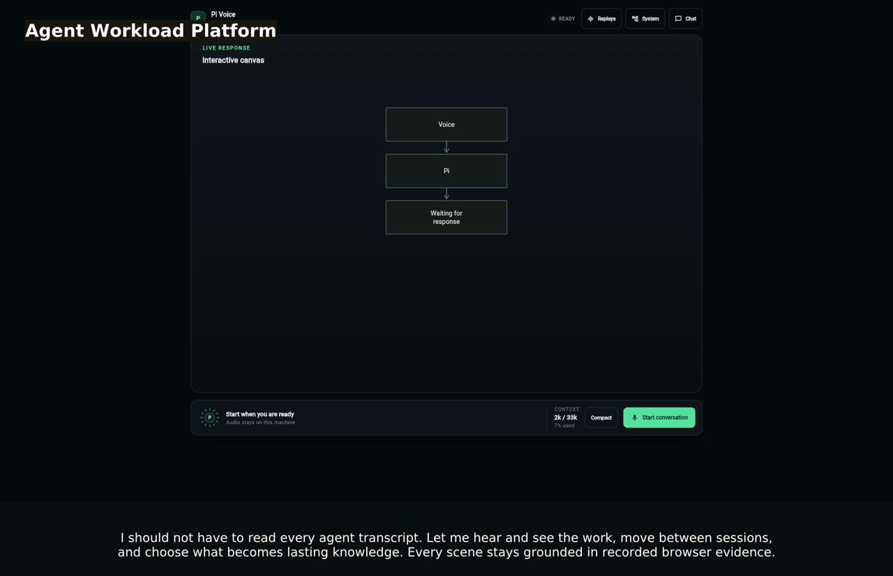

# Voice Agent

A private browser voice interface for the Agent Workload Platform on Apple Silicon. Docker Compose
runs the browser-facing voice edge, Tailscale ingress, narrow task gateway, and Postgres. MLX,
Ollama, Pi, Gondolin, and Wassette remain native on macOS where Apple acceleration and VM-backed
tool isolation are available.

The [C4 architecture views](docs/architecture/README.md) include the deployment and security
boundaries as authoritative Mermaid sources.

[](docs/assets/voice-agent-demo.mp4)

[Read the timed video transcript](docs/assets/voice-agent-demo.srt).

The conference-style tour starts with a developer who would rather listen to,
see, and explore agent work than read long conversations. Public synthetic
content shows a live voice session, a switch to durable work, and Mermaid,
Marp, and editable Excalidraw views. Playwright Trace Viewer and Grafana let
the developer inspect browser evidence and telemetry. Journal Review closes
the story: source-backed, human-chosen knowledge may eventually shape a
digital professional twin, but extraction alone is not memory. Rebuild its
Playwright trace, narration, transcript, poster, and MP4 locally with
`make playwright-readme-demo`; the workflow does not require Tailscale. Named
`Tour:` steps are both browser actions and grounded speaker notes. Full-size
1920×1080 MCP App captures preserve readable evidence, while the container
worker emits Kokoro audio, captions, and payload-free render telemetry.

Listen to **Let Me Hear the Work** in its
[contemporary R&B](docs/assets/let-me-hear-the-work.m4a) or
[late-1950s soul](docs/assets/let-me-hear-the-work-soul-take.m4a) arrangement.
The [pull request soundtrack workflow](../../docs/pull-request-soundtrack-workflow.md)
documents lyric review, durable rendering, artifact checks, and publication.

## Product structure

Deployable processes live in `apps/`. Code shared by multiple apps lives in `packages/`.

```text
apps/       web, edge, pi-agent, broker, gateway, worker
packages/   tasking, telemetry
deploy/     Compose, macOS services, Tailscale, secrets, observability
scripts/    setup, operation, and verification
tests/      end-to-end probes
docs/       product architecture
```

The product vocabulary is defined in [GLOSSARY.md](GLOSSARY.md). Repository-wide
ownership and planned extractions are documented in
[Monorepo organization](../../docs/monorepo-organization.md).

## Trust model

- Tailscale Serve terminates trusted tailnet HTTPS, enforces tailnet access, strips spoofed
  identity headers, and injects the authenticated login before forwarding to Traefik over shared
  loopback. Before routing, Traefik asks the edge to match that login against the configured owner.
  It routes `/` to Pipecat, `/metrics/` to Grafana, `/git/` to Gitea, and `/oxigraph/query` to the
  bounded knowledge query route. Funnel and public Docker ports are not enabled.
  Grafana provisions a generated **C4 Operational Heat Map** containing C1, C2, every C3 view, and
  deployment, plus the dated source-backed code evidence snapshot. A deterministic local adapter
  compiles the authoritative Mermaid sources before Compose starts. Grafana renders the repository's
  Mermaid sources with the pinned Grafmaid plugin. On the C2 container view, fixed PromQL queries
  color node fills for missing/stale, idle, and increasing activity while node borders show
  source-backed evidence. C1, C3, and deployment backgrounds stay neutral gray so the live C2 trace
  is the sole color highlight; traffic volume is deliberately not presented as health. Grafana is the only system coverage and
  operational-health surface.
  The pinned official Grafana MCP server provides read-only dashboard, Prometheus, and Tempo tools
  to authenticated MCP clients. Its Tempo tool includes Grafana's interactive trace MCP App;
  the voice-chat client renders that upstream App inline with its dark host theme. The C4 dashboard
  itself remains a Grafana dashboard rather than a custom MCP App.
- Browser sessions require an exact HTTPS origin and a signed, one-use token in the WebSocket path.
  The current deployment is deliberately single-user: login pins exactly one owner identity during
  setup, while tailnet ACLs authenticate which devices can reach the listener.
- The voice edge is non-root, read-only, capability-free, resource-bounded, and has no host mount or
  Docker socket.
- Separate bearer capabilities expose only bounded inference and propose/status/approve/cancel.
- Voice edge and gateway containers use Docker's `none` log driver; Pipecat's shared Loguru handler
  is removed so transcripts, LLM context, and audio-adjacent payloads are never formatted as logs.
- OpenTelemetry exports only manually defined, low-cardinality operation counts, durations, and
  traces. It has no log exporter and records no audio, text, identity, workspace, proposal ID,
  exception message, URL parameter, request body, or response body.
- Database credentials, Pi/provider authentication, sessions, and writable workspaces never enter the voice
  container.
- Oxigraph runs as a persistent SPARQL 1.1/RDF store on the Compose `data` network and publishes its
  unauthenticated endpoint only on Mac loopback at `127.0.0.1:7878`. The Agent Gateway retains its
  fixed, bounded personal-knowledge API, while the isolated Pi Voice VM also receives direct query
  and update access through `/opt/awp/bin/oxigraph`. This is an explicit YOLO-mode capability: it is
  not reachable from the LAN or tailnet, but agent-issued SPARQL can mutate the complete RDF store.
- The Pi worker runs on macOS, but Pi's standard `read`, `write`, `edit`, and
  `bash` tools are backed by Gondolin micro-VMs. Durable tasks mount their task
  workspace at `/workspace`; the persistent voice VM shallow-clones committed source
  from Gitea into its local `/workspace`. Browser and permission-scoped Wassette
  tools are additional capabilities.
- Durable delegation is deliberately **YOLO voice submission** for now: the Pi
  Voice Service may create and immediately queue a task when the owner asks for
  asynchronous work. A separately created proposal still requires a later
  explicit approval turn. The gateway binds approvals to identity, proposal,
  plan hash, and expiry. This is convenient, not phishing-resistant; a UI or
  Face ID/WebAuthn capability should replace the side-effect boundary later.

Docker Desktop's Linux VM is the voice-service isolation boundary. Its containers share that VM,
so this is intentionally simpler and weaker than a dedicated per-service micro-VM. The risky agent
tools still execute through Gondolin rather than in the voice stack.

## Start

```bash
cd products/voice-agent
make setup
# Configure deploy/.env and the service files under deploy/host-env.
make pull-model
make host-preflight
make start
make login
make warm-models
```

The repository-root `Makefile` is the main entry point. This product Makefile
remains usable from this directory and owns product-specific orchestration.
Every WASM module owns its build implementation in its component directory;
run `make wasm-build`, `make wasm-check`, or `make wasm-install` here to invoke
the same interface across all components.

`make start` deploys in the background. Use `make up` to deploy and then follow
bounded container output together with the native broker, Pi voice, and worker
stdout; `Ctrl-C` stops following output but leaves the services running. Use
`make logs` to follow an already-running deployment.

`make login` performs interactive Tailscale authentication when needed, binds the exact login and
MagicDNS origin, enables one tailnet-only HTTPS origin on port 443, and prints the voice, metrics,
Git, and task URLs.

## Browser URL

The current private deployment is available to authenticated devices in this
tailnet at:

<https://pipecat-edge.tailf6d713.ts.net>

The MagicDNS name and TLS certificate belong to the Tailscale node, so the URL
can remain configured while the application is unavailable. A `tailscale
serve status` result such as `proxy http://127.0.0.1:8080` proves only that the
HTTPS route exists. The `voice-edge` container must also be running in the same
network namespace and listening on port 7860, and Traefik must be listening on port 8080.

Check the complete path with:

```bash
make status
docker exec pipecat-mlx-voice-tailscale-1 tailscale serve status
```

If the proxy exists but the page does not open, use `make up`, wait for
`voice-edge`, `agent-gateway`, Postgres, and S3Mock to become healthy, and then
run `make verify`. Open the URL from a device connected to the same tailnet;
the Mac's ordinary DNS resolver does not need to resolve the private MagicDNS
name when the Mac itself is not connected as a Tailscale client.

## Operate

```bash
make status       # Compose services, tailnet state, native service state
make start        # deploy, verify, and return after services become healthy
make up           # deploy, verify, and follow service stdout
make native-status # inspect all eight launchd services
make native-start  # start the installed native services; Compose dependencies must be running
make native-stop   # unload the native services in reverse order
make native-restart # restart the native services and wait for model readiness
make logs         # follow container and native-service stdout
make verify       # isolation, capabilities, ingress, broker, and gateway checks
make grafana-password # print the local Grafana credential after make up
make recreate     # immutable container recreation plus verification
make cycle-test   # three stop/recreate/schema cycles plus final recovery
make benchmark-mlx # warm CPU, RSS, tokens/s, and realtime-factor benchmark
make publish-workspace WORKSPACE_ID=agent-workload-platform REPOSITORY=/path/to/repository
make blackbox-voice UTTERANCE="Propose a task in the default workspace to inspect it"
make blackbox-e2e # synthetic voice through Pipecat plus a Postgres assertion
make playwright-grafana # render every C4 panel and attach colors, screenshot, and trace
make digital-twin-pull-judge # download the official Selene 1 Mini Q4 judge for LM Studio
make digital-twin-load-judge # load Selene with the API identifier used by the eval
make digital-twin-eval # compare Von, optional Jev, and local Clef; LM Studio Selene judges outputs
make digital-twin-judge-calibration # run grouped development/holdout judge calibration
make digital-twin-judge-report RESULTS=digital-twin/eval/results/judge-calibration.json
make down         # stop native and Compose services; preserve Postgres and Tailscale volumes
make check        # tests, lint, type checks, build, Compose and plist validation
```

`make start` installs and starts the native services after Postgres, S3Mock, and Gitea are healthy.
Use `make native-start` after installation when those container dependencies are already running.
`make native-stop` unloads the services, so launchd will not immediately restart jobs configured
with `KeepAlive`. `make down` stops native services before stopping Compose. `make native-status`
reads launchd state without changing it; `make verify` checks service readiness.

Postgres and S3Mock are published only on host loopback so the native Pi worker can consume the
Pi Durable task state and immutable workspace bundles. The bearer-protected agent gateway is also published on
host loopback so the optional Pi voice backend can use bounded task-lifecycle and read-only
personal-knowledge operations.
The same gateway exposes a review-gated durable music workflow. Creating a generation starts an
attachable Pi session that writes a bounded lyric manifest. A later explicit render command sends
the reviewed manifest to a loopback-only ACE-Step host API, encodes the result as M4A, and stores it
in S3Mock. The browser retrieves completed audio through the identity-checked edge proxy; model
weights, S3 credentials, lyrics, and audio never enter MCP arguments or OpenTelemetry.
The host-service install pins ACE-Step 1.5 in the persistent `PipecatEdge/apps/music-generation`
directory and runs its loopback API as a launchd service. `make start` installs and starts it;
`make status` shows its launchd state. The first start may take several minutes while the model
downloads and loads. `make verify` checks that both audio and language models are ready.
The native inference broker listens on `127.0.0.1:9443`; Docker Desktop makes that protected
capability available through the private `inference-broker` host-gateway alias. No service listens
on the Mac LAN interface; browser access is available only through the tailnet listener.

S3Mock stores committed Git bundles and result patches in a Docker named volume; it never
bind-mounts `~/Documents`. Each task verifies the bundle digest, expands it beneath
`~/.local/share/agent-workload-platform/workspaces`, uploads its patch/status/result, and deletes
the scratch directory. The mock validates the local artifact contract, not production IAM or
durability; swap its endpoint for a real S3-compatible service before relying on those guarantees.

Raw microphone input and the selected filter output are retained as WAV files for the five most
recent completed conversations in the private `voice-diagnostics` Docker volume. The
tailnet-authenticated **Replays** page exposes those two versions for listening; the oldest session
is deleted after the sixth completes. Recording stops at `VOICE_DIAGNOSTIC_MAX_SECONDS` per session,
and audio is never exported to OpenTelemetry. The same page uses WaveSurfer for replay waveforms
and raw/VoxLock spectrograms, and Recharts for input/output energy, suppression, per-filter
latency, LSTM-state activity, and the model's predicted complex-mask magnitude. The edge image
instruments the digest-verified VoxLock ONNX graph at build time to expose that mask; it records
only frequency-band aggregates, not model tensors. The live view polls a bounded microphone
envelope rather than sending replayable audio samples. Synthesized speech exists only in memory while
streaming. Transcripts remain in the in-memory conversation context for the active call and are
discarded with it. Postgres stores only an explicitly proposed task instruction. The Pi Durable
owner retains each task conversation in native SQLite so the voice agent can attach to the
still-running or recently settled task. The owner manages a mode-0600 Unix socket that accepts
only bounded conversational commands; its
outbound projection includes assistant text and command status, never model reasoning, tool arguments,
or tool results. Native launch services still write stdout and stderr to `/dev/null`, and the synthetic
black-box runner reports event counts, never transcript text.

The server-side microphone filter is selected with `VOICE_INPUT_FILTER=rnnoise|voxlock`; RNNoise
is the rollback default. Only the selected filter is initialized and executed; its output continues
to VAD and transcription and is retained beside the raw input for diagnostics. VoxLock
uses the host WAV named by `VOXLOCK_VOICE_SAMPLE_SOURCE`.
`make up` validates mono 16 kHz PCM16 input, extracts the strongest three seconds from its first
15 seconds, and writes only that derived sample to an ignored mode-0600 Compose secret. The edge
loads hash-verified ONNX models baked into its image and runs with Hugging Face networking disabled.
VoxLock is target-speaker isolation, not authentication or liveness detection. See the
[VoxLock implementation and validation guide](../../docs/research/voxlock-pipecat-integration.md).
Silero VAD keeps Pipecat's recommended `stop_secs=0.2`; `LocalSmartTurnAnalyzerV3` decides when a
spoken turn is complete. Parakeet TDT 0.6B v3 on MLX receives every completed audio segment directly—there is no
speaker-authentication gate. The selected input filter runs before VAD and transcription.
Payload-free metrics distinguish accepted audio, emitted or empty
transcripts, Smart Turn inference triggers, completed turns, and stop timeouts without exporting
audio or transcript text.

## Local observability

The pinned `grafana/otel-lgtm` development bundle provides Grafana, Prometheus, Tempo, and an OTLP
collector. From an authenticated tailnet device, open
<https://pipecat-edge.tailf6d713.ts.net/metrics/>; Grafana trusts only the identity header injected
by Tailscale through the localhost-only Traefik ingress and does not ask for another password.
Direct Mac-loopback access at
<http://127.0.0.1:3300> still requires user `admin`; obtain its generated password with
`make grafana-password`. Edge, inference broker, Pi voice, agent gateway, task worker, and the
image-builder manager export the same payload-free OpenTelemetry operation metric and traces with
distinct `service.name` resources. The builder VM pins Gitea Runner 4.1 and routes its native OTLP job
traces and runner metrics to the same loopback collector as `pipecat-gitea-runner`; the collector is
not exposed by the VM or application containers. The provisioned **Voice Product Health** dashboard follows the product
journey from detected speech through transcript, Pi inference, and reply audio. It also shows turn
outcomes, voice-filter pass rate, user-perceived and inference-stage latency, task activity,
failures, and recent payload-free traces.
The provisioned **Storage Capacity** dashboard shows host APFS free space, selected Gondolin
directories, and Docker usage and reclaimable space. Host capacity comes from Fluent Bit's
`node_exporter_metrics` filesystem collector; its `exec` and `log_to_metrics` plugins publish
the directory and Docker gauges once a minute. A Go helper calls Docker's Engine SDK directly
for byte-precise disk usage and reclaimable totals.

The pinned official `grafana/mcp-grafana` service is available only on Mac loopback at
`http://127.0.0.1:8000/mcp`. Compose creates a Viewer service account for its Grafana connection,
requires a separate caller bearer token, disables write tools and anonymous usage reporting, and
enables only dashboard discovery, Prometheus, Tempo, navigation, and identity tools. Compatible MCP
hosts render the bundled Tempo waterfall App; the
stable v2.0.2 Prometheus tool returns structured/text results without the unreleased metrics App.
Pi Voice registers this server explicitly as a deferred provider. When it returns a bounded trace
reference, Voice Edge identity-checks the browser, retrieves the official App resource and structured
trace data server-side, and passes them through the existing sandboxed MCP Apps bridge. The caller
token never enters model output or browser JavaScript.
`make grafana-mcp-token` prints the local caller token for an explicitly configured development client.

The provisioned **Platform Resources** dashboard separates three resource layers: the physical Mac,
the Docker Desktop Linux VM, and each running Gondolin QEMU runner. Native Fluent Bit reports macOS
CPU, active+wired memory, load, disk, and network metrics. The Compose Fluent Bit instance reads the
Docker VM's `/proc` and `/sys` read-only. A small loopback-only host exporter reports CPU, resident
memory, uptime, and configured limits for every registered voice or task Gondolin VM. It exports no
process command lines, guest data, audio, or transcript content.

CPU busy is average non-idle time across a system's logical CPUs. Docker memory uses `MemAvailable`;
the Mac panel uses active plus wired memory and is deliberately labelled as an approximation, not
Apple's Memory Pressure indicator. Load per CPU near 100% means roughly one runnable job per logical
CPU; a sustained higher value means work is queueing. Disk and network panels are throughput, not
latency. A Gondolin VM's resident memory is the host QEMU process RSS, not guest-visible used memory.
Task VMs appear only while a task is executing.

Mac and Docker measurements are nested: Docker activity is already part of the physical Mac total,
so never add those lines together. Similarly, use the product dashboard and traces to correlate a
resource spike with a voice operation rather than attributing every system-wide spike to voice.
Both native endpoints bind only to Mac loopback; OTel reaches them through Docker's host gateway.

The Pi Durable owner keeps task state in a private SQLite store and exposes a
mode-0600 local socket for native inspection, abort, and retry. The Gateway uses
its authenticated loopback HTTP interface to submit and query approved tasks.
The owner endpoint is not routed through Tailscale ingress.

Grafana, Grafana MCP, and OTLP/HTTP bind only to Mac loopback. OTLP/gRPC, Prometheus, Tempo, and Loki ports are not
published. Gateway and edge stdout is retained only in bounded local Docker logs for `make logs`;
applications do not send the OpenTelemetry logs signal. Telemetry is stored in the
`otel-lgtm-data` Docker volume; Prometheus retention is seven days. This all-in-one bundle is for
private local monitoring, not production.

The same authenticated origin serves the voice UI at `/`, the committed source mirror at `/git/`,
and the knowledge query route at `/oxigraph/query`. Tailscale authenticates the connection and strips spoofed identity
headers; Traefik then uses the edge's forward-auth endpoint to require the exact configured owner
before any route is served. Prometheus, OTLP, the Agent Gateway, S3Mock, Postgres, and the Traefik
dashboard have no tailnet route.

For browser testing on the Docker host, the voice UI is also available at
<http://127.0.0.1:8080>. This ingress is published on host loopback only and maps to a separate
Traefik entry point. Traefik marks requests from that entry point, while every tailnet router removes
client-supplied copies of the marker. The edge accepts the marker only when
`EDGE_ALLOW_LOCAL_INGRESS=true` and resolves it to the sole configured edge owner. Set
`VOICE_LOCAL_PORT` to change the host port or `EDGE_ALLOW_LOCAL_INGRESS=false` to disable it.

The black-box runner synthesizes speech with Kokoro, streams it through the same authenticated
WebSocket used by the browser, transcribes it with Parakeet v3 on MLX, and exercises the LLM/tool path.
Before Tailscale login it uses `deploy/compose.local-test.yml` as a non-listening network anchor;
set `BLACKBOX_USE_TAILSCALE=true` to test an authenticated tunnel namespace. See
[TESTING.md](TESTING.md) for assertions and failure interpretation.

Set `VOICE_LLM_BACKEND=pi` in `apps/edge/.env` to select the alternate
`Parakeet v3 -> Pi agent -> capability-scoped Wassette components -> Kokoro` path. The default remains `ollama`.
Pi voice uses a dedicated long-running Node service built on Pi's `createAgentSession()` SDK. The
service keeps conversation state between turns, reconciles a restarted or reset Pipecat transcript,
and consumes tasking and read-only personal-knowledge tools from Wassette. Its native
read, write, edit, and bash operations run only inside the persistent Gondolin voice VM.
On VM startup, the service shallow-clones `main` from its private Gitea mirror into the
guest-local `/workspace` (repository name: `PI_VOICE_GITEA_REPOSITORY`, default
`agent-workload-platform`). Reusable skills are the only host mount, read-only at `/skills`.
The clone is writable inside the VM and contains committed source at VM startup; host
uncommitted changes and later commits require a new clone or explicit Git refresh. Gitea
receives committed refs during `make start`; the VM receives no publisher credential.
The service disables discovered
host extensions, prompt templates, themes, and context files. The service explicitly registers
Wassette through Pi's native MCP extension as a deferred tool provider; `tool_search` discovers
tools from the configured component directory without adding every schema to each turn, and the
host-native Wassette child process receives only a dedicated capability env file. WAC composes each
TypeScript core with its authenticated gateway adapter. The personal-knowledge component receives
a separate reader token that cannot enqueue work or write RDF. Wassette is separate
from the Gondolin VM used for native file and shell tools.
The same VM mounts a read-only `oxigraph` CLI and reaches the loopback-published store through one
synthetic network origin. `oxigraph query`, `oxigraph update`, and `oxigraph graphs` intentionally
provide unrestricted RDF access; they should be replaced by reviewed domain operations before this
becomes a multi-user deployment.

When a durable task is running, ask the voice agent to attach using the returned lowercase `task_id`.
The first turn invokes `attach_task_session`; later voice turns are sent directly to that task's
Pi Durable conversation in the owner process and therefore use its existing context, workspace,
tools, and Gondolin VM. No worker LLM,
database transcript projection, or polling loop sits between the two sessions. Disconnecting voice
releases the attachment, and an unattached settled task closes after the bounded idle grace.
`make test-pi-durable-mcp` exercises the native conversation, a real Gondolin VM write when
local assets exist, and follow-up through the voice agent's task socket client.
With `OTEL_EXPORTER_OTLP_ENDPOINT` configured, the Pi Durable owner emits payload-free
`remote.attach` and `remote.prompt` operation counters.
Kokoro speaks the final text produced
by Pi after any tool calls complete. `PI_VOICE_MODEL` selects the model; when blank, Pi uses its
configured default. The VM image includes AWS CLI and receives mock-only credentials plus a
synthetic `S3_ENDPOINT_URL`. Gondolin denies general egress and rewrites only that synthetic origin
to loopback-published S3Mock, allowing Pi to inspect `s3://$S3_BUCKET` without general network
access. The image also includes `promtool`; `PROMETHEUS_URL` points to a separately allowlisted
synthetic origin backed by Prometheus's loopback-only host port, so Pi can query telemetry without
receiving access to Grafana credentials or the Docker monitoring network.

Gitea uses rootless mode, SQLite, and named Docker volumes. Registration and SSH are disabled.
Actions schedule trusted image builds; completed image archives stay in the host's local handoff folder. `tools/ops/gitea_sync.py`
creates the publisher account and repository idempotently, then
mirrors only committed refs from this repository. Gitea is reachable from macOS only on
`http://127.0.0.1:3001`; Gondolin can reach only its synthetic read endpoint and S3Mock, with all
other VM network destinations denied.

The VM image includes the checksum-verified `tea` CLI. Deployment provisions a separate
`voice-admin` Gitea administrator account with an `all`-scoped token for the persistent
voice VM's Tea login `local`. The restricted `voice-agent` account and its read-only token
remain available to the task worker. The deployment-only `source-publisher` credential
does not enter the VM.

Project-specific task images are declared in `.pi/gondolin.json`. Before Pi starts, the task worker
checks the local versioned handoff folder and dispatches the repository's fixed Gitea workflow on a miss. One shared, capacity-one
Gitea Runner executes trusted repository workflows inside a warm Gondolin builder VM. The build context is sent to the host Docker Job API, which builds through the host Docker Engine and writes the image tar to that handoff folder. The task worker imports the tar and registers the requested Gondolin image reference. Pi then starts one
VM for the task's session using the repository's `.pi` policy. The builder VM is a
shared trust domain, so only administrator-approved repositories may use its runner label.

See [BENCHMARKS.md](BENCHMARKS.md) for the measured M4 Pro CPU, unified-memory, LLM throughput,
and speech realtime factors, plus the reproducible benchmark command.

See [HOST_REQUIREMENTS.md](HOST_REQUIREMENTS.md) for the host contract and
[docs/architecture](docs/architecture/README.md) for responsibility and threat-boundary details.
