# Open-world knowledge and closed-world classification — C3 component view

**Audience:** developers evolving the digital-twin ingestion, learning, and ontology lifecycle.

**Decision illustrated:** allow extraction and Oxigraph to retain novel grounded knowledge without silently expanding the deployed classifier's calibrated label space.

**Software system:** the personal digital twin. This view zooms into the Digital Twin Ingestion Runtime container; model services, storage, review, evaluation, and ontology governance remain external containers.

The editable Mermaid source is [open-world-knowledge-c3.mmd](open-world-knowledge-c3.mmd).

## Reading the diagram

- **Green is open world:** the journal extractor can preserve a grounded novel concept as `unclassified`, and Oxigraph can store new evidence and relationships without changing the classifier.
- **Red is closed world:** SystemOne answers against the exact classes and criteria in ontology version N so probabilities, calibration, and regression metrics remain meaningful.
- **Purple is the governance loop:** only reviewed evidence enters dataset curation. A proposed ontology version is evaluated and published as a new immutable release before runtime consumes it.
- **Teal with a heavy border is HITL:** the owner is the authority, and the gateway is the explicit runtime review boundary. Color is reinforced by `[HITL]` labels so the meaning survives monochrome rendering.
- There is deliberately no direct Oxigraph-to-classifier update path. Database growth cannot silently change classifier behavior.

## Important runtime sequence

1. A completed owner turn is split into independently retryable journal and classifier work.
2. Journal extraction discovers grounded durable entries, including `unclassified` entries for meaningful concepts outside its current types.
3. SystemOne selects from a frozen assertion ontology; typed extraction runs only after that bounded decision.
4. Schema and grounding checks protect both paths before the gateway writes to Oxigraph.
5. Owner review creates the authoritative feedback used by the offline learning and ontology-governance loop.
6. Ontology expansion produces version N+1, new reviewed examples, new split manifests, and a fresh baseline. It does not mutate version N in place.

## Build-time learning, evaluation, and training C3 view

Build-time improvement is a separate container with different dependencies and permissions, so it has its own C3 component view rather than being mixed into the production-runtime diagram:

The editable Mermaid source is [open-world-knowledge-build-time-c3.mmd](open-world-knowledge-build-time-c3.mmd).

In the build-time view, teal components are the human-in-the-loop control points: the owner authorizes scope, the Experiment Contract Controller freezes that approved authority before any loop starts, and the Promotion Coordinator blocks release until the owner approves the exact qualified artifact and rollback plan.

| Stage | Main responsibility | Authority and artifacts |
| --- | --- | --- |
| Reviewed export | Convert owner feedback into redacted, validated examples and semantic-family-disjoint splits. | Oxigraph owns feedback; DVC versions private dataset manifests and reproducibility evidence. |
| Prompt-first autoresearch | Improve prompts, examples, criteria, thresholds, model selection, filters, and grounding before adding a model lifecycle. | Git owns prompts and policies. Promptfoo and the journal harnesses measure development/challenge behavior. The locked holdout stays outside the loop. |
| Training evidence gate | Decide whether residual reviewed errors represent model capacity rather than unclear policy, label noise, threshold choice, or missing deterministic validation. | Training requires a frozen baseline, demonstrated plateau, explicit hypothesis, compute budget, safety gates, and an explicit user request. |
| Oumi training | Run bounded generative SFT, LoRA, or QLoRA for an approved journal-extraction target. | Oumi analyzes reviewed exports and produces checkpoints. Its loss and generic evals are diagnostic, not release criteria. |
| Clef training | Train the SystemOne joint schema head and approved LoRA parameters. | Clef requires its custom trainer; generic Oumi/TRL text SFT is not equivalent. Oumi may organize the job only if it invokes that trainer faithfully. |
| Observation | Detect unhealthy or wasteful runs without leaking private examples. | Oumi output and TensorBoard hold local diagnostics. OTel receives bounded run/resource signals. Oumi's `enable_mlflow` may target the existing MLflow service only for approved tracked runs. |
| Product qualification | Exercise the exact candidate through the same inference boundary used by production. | Promptfoo remains the classifier gate; journal extraction, repeated-run, and paraphrase harnesses gate journal behavior. One frozen candidate receives one locked-holdout qualification run. |
| Packaging and registration | Verify that merging or quantization did not change behavior, then preserve immutable lineage. | Re-run product evaluation after packaging. MLflow can register the qualified immutable model version; DVC keeps dataset/config/report pointers rather than duplicating the model. |
| Promotion and deployment | Move a qualified artifact into operational use with rollback. | Qualification never implies promotion. Alias changes and deployment require an explicit decision, exact digest, rollback target, and post-deployment observation plan. |

### Why training loss is not the goal

Build-time training metrics such as loss, learning rate, throughput, MFU, memory, and numeric health answer whether optimization is functioning. They do not answer whether the digital twin behaves correctly. Candidate selection therefore uses product metrics through the real boundary:

- SystemOne: macro and per-class F1, false-durable rate, review coverage, Brier score, calibration, probability-contract validity, robustness, and latency.
- Journal: entry precision/recall/F1, false-memory rate, missed-entry rate, type quality, exact grounding, schema validity, repeated-run agreement, paraphrase robustness, edit burden, and latency.

Autoresearch chooses a development incumbent using one declared primary objective plus independent safety gates. It cannot trade a safety regression for a higher aggregate score or open the locked holdout to generate its next hypothesis.

## Assumptions and open questions

- The diagram reflects the current separate journal and classifier task branches and fixed-shape gateway writers.
- `Learning & Ontology Governance` is a conceptual offline container covering reviewed export, curation, bounded autoresearch, and release qualification; it is not a production runtime dependency.
- Promptfoo remains the classifier release gate, while journal extraction, repeated-run, and paraphrase harnesses qualify journal behavior.
- Decide later whether ontology proposals need a dedicated owner-facing workflow; the architecture currently requires review but does not assume a particular UI.
