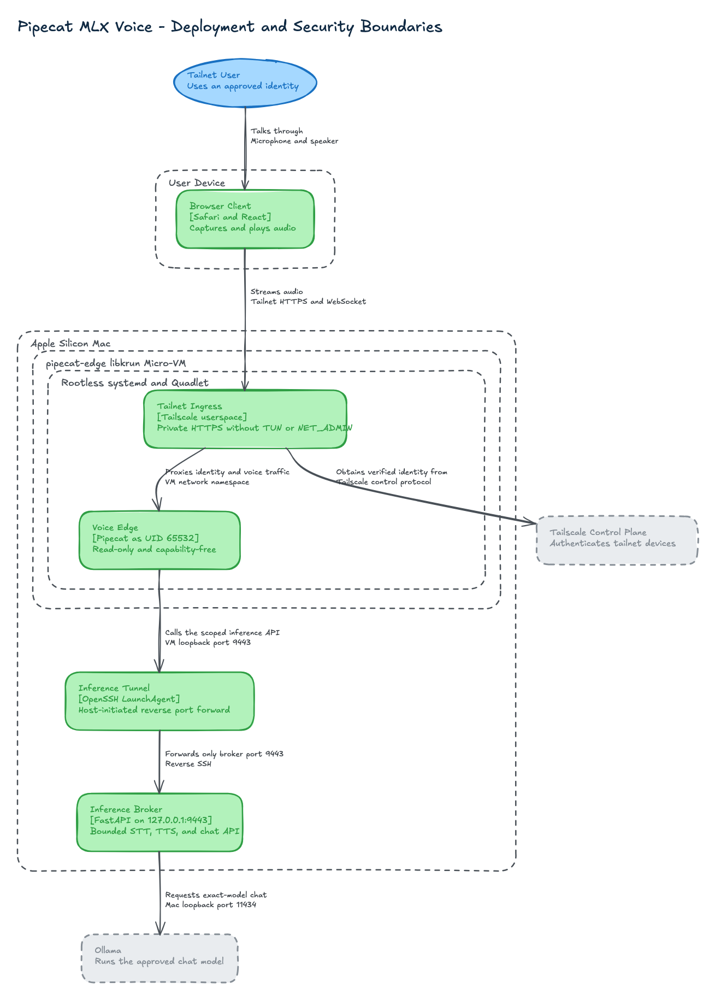

# Pipecat MLX Voice

A private browser voice interface for the Agent Workload Platform on Apple Silicon. Docker Compose
runs the browser-facing voice edge, Tailscale ingress, narrow task gateway, and Postgres. MLX,
Ollama, Pi, Gondolin, and Wassette remain native on macOS where Apple acceleration and VM-backed
tool isolation are available.

[](docs/architecture/deployment-security.excalidraw)

The [C4 architecture views](docs/architecture/README.md) include the editable Excalidraw scene and
SVG render.

## Trust model

- Tailscale Serve provides private raw-TCP ingress to a capability-free Caddy sidecar that
  terminates the tailnet certificate and advertises HTTP/1.1 only. Funnel and public Docker ports
  are not enabled. This bypasses Serve's incompatible HTTP/2 WebSocket reverse proxy.
- Browser sessions require an exact HTTPS origin and a signed, one-use token in the WebSocket path.
  The current deployment is deliberately single-user: login pins exactly one owner identity during
  setup, while tailnet ACLs authenticate which devices can reach the listener.
- The voice edge is non-root, read-only, capability-free, resource-bounded, and has no host mount or
  Docker socket.
- Separate bearer capabilities expose only bounded inference and propose/status/approve/cancel.
- Voice edge and gateway containers use Docker's `none` log driver; Pipecat's shared Loguru handler
  is removed so transcripts, LLM context, and audio-adjacent payloads are never formatted as logs.
- OpenTelemetry exports only manually defined, low-cardinality operation counts, durations, and
  traces. It has no log exporter and records no audio, text, identity, workspace, proposal ID,
  exception message, URL parameter, request body, or response body.
- Database credentials, Pi/provider authentication, sessions, and writable workspaces never enter the voice
  container.
- The Pi worker runs on macOS with built-in host tools disabled. Its explicit
  `gondolin_bash` tool runs inside a Gondolin micro-VM with only the immutable
  task workspace mounted at `/workspace`; browser and permission-scoped
  Wassette tools are additional capabilities.
- Approval is deliberately **YOLO voice approval** for now: Pipecat reads the exact pending plan and
  a later explicit spoken approval releases it. The durable gateway binds approval to the identity,
  proposal, plan hash, and expiry. This is convenient, not phishing-resistant; Face ID/WebAuthn can
  replace only the approval adapter later.

Docker Desktop's Linux VM is the voice-service isolation boundary. Its containers share that VM,
so this is intentionally simpler and weaker than a dedicated per-service micro-VM. The risky agent
tools still execute through Gondolin rather than in the voice stack.

## Start

```bash
cd workloads/pipecat-mlx-voice
make setup
# Fill server/.env using server/.env.example, including fresh random secrets.
make pull-model
make host-preflight
make up
make login
make warm-models
```

`make login` performs interactive Tailscale authentication when needed, binds the exact login and
MagicDNS origin, issues the tailnet certificate, enables tailnet-only raw TCP on HTTPS 443, and
prints the browser URL.

## Operate

```bash
make status       # Compose services, tailnet state, native service state
make verify       # isolation, capabilities, ingress, broker, and gateway checks
make grafana-password # print the local Grafana credential after make up
make recreate     # immutable container recreation plus verification
make cycle-test   # three stop/recreate/schema cycles plus final recovery
make benchmark-mlx # warm CPU, RSS, tokens/s, and realtime-factor benchmark
make publish-workspace WORKSPACE_ID=agent-workload-platform REPOSITORY=/path/to/repository
make blackbox-voice UTTERANCE="Propose a task in the default workspace to inspect it"
make blackbox-e2e # synthetic voice through Pipecat plus a Postgres assertion
make down         # stop Compose services; preserve Postgres and Tailscale volumes
make check        # tests, lint, type checks, build, Compose and plist validation
```

Postgres and S3Mock are published only on host loopback so the native Pi worker can consume the
queue and immutable workspace bundles. The native inference broker listens on `127.0.0.1:9443`; Docker Desktop makes that protected
capability available through the private `inference-broker` host-gateway alias. No service listens
on the Mac LAN interface; browser access is available only through the tailnet listener.

S3Mock stores committed Git bundles and result patches in a Docker named volume; it never
bind-mounts `~/Documents`. Each task verifies the bundle digest, expands it beneath
`~/.local/share/agent-workload-platform/workspaces`, uploads its patch/status/result, and deletes
the scratch directory. The mock validates the local artifact contract, not production IAM or
durability; swap its endpoint for a real S3-compatible service before relying on those guarantees.

Raw audio and synthesized speech exist only in memory while streaming. Transcripts remain in the
in-memory conversation context for the active call and are discarded with it. Postgres stores only
an explicitly proposed task instruction. Queue workers run Pi with `--no-session`, and native
launch services write stdout and stderr to `/dev/null`, so agent conversations are not retained as
Pi session JSONL. The synthetic black-box runner reports event counts, never transcript text.

## Local observability

The pinned `grafana/otel-lgtm` development bundle provides Grafana, Prometheus, Tempo, and an OTLP
collector. Open <http://127.0.0.1:3300>, use user `admin`, and obtain the generated local password
with `make grafana-password`. The provisioned **Pipecat Voice Overview** dashboard shows operation
rates, p95 durations, errors, and recent traces for the voice edge, gateway, and native MLX
inference broker.

Grafana and OTLP/HTTP bind only to Mac loopback. OTLP/gRPC, Prometheus, Tempo, and Loki ports are not
published. Application and bundle Docker logs remain disabled, and applications do not send the
OpenTelemetry logs signal. Telemetry is stored in the `otel-lgtm-data` Docker volume; Prometheus
retention is seven days. This all-in-one bundle is for private local monitoring, not production.

The black-box runner synthesizes speech with Kokoro, streams it through the same authenticated
WebSocket used by the browser, transcribes it with MLX Whisper, and exercises the LLM/tool path.
Before Tailscale login it uses `deploy/compose.local-test.yml` as a non-listening network anchor;
set `BLACKBOX_USE_TAILSCALE=true` to test an authenticated tunnel namespace. See
[TESTING.md](TESTING.md) for assertions and failure interpretation.

See [BENCHMARKS.md](BENCHMARKS.md) for the measured M4 Pro CPU, unified-memory, LLM throughput,
and speech realtime factors, plus the reproducible benchmark command.

See [HOST_REQUIREMENTS.md](HOST_REQUIREMENTS.md) for the host contract and
[docs/architecture](docs/architecture/README.md) for responsibility and threat-boundary details.
