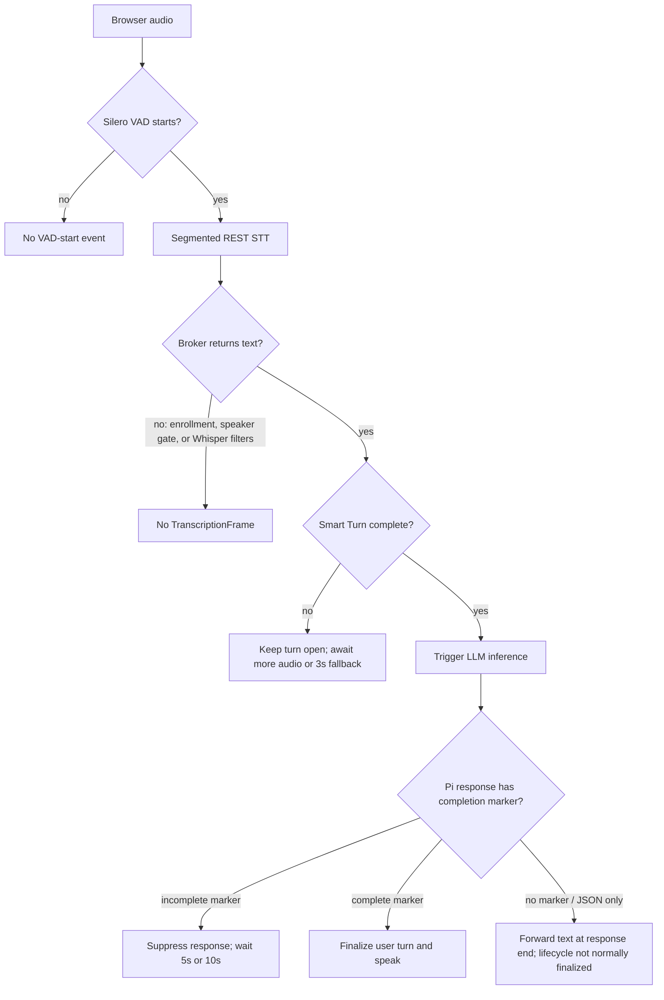

# Pipecat turn-detection audit

Date: 2026-10-13

Scope: Pipecat 1.12.0, pinned by `edge/uv.lock`, compared with the current
`edge/bot.py` and host inference broker. Sources are Pipecat's official
documentation and the first-party Pipecat 1.12.0 source tag.

## Executive finding

`VADParams(stop_secs=0.2)` is correct for Smart Turn and should not be raised as
the first fix. Pipecat calls `0.2s` the recommended low-level VAD threshold and
says to tune conversational waiting in the stop strategy instead. Smart Turn's
own model decides whether a pause ends the turn, with a separate 3-second
maximum-silence fallback.

The current stack has four more plausible explanations for "speech was detected,
but no transcript/turn reached Pi":

1. Owner-speaker verification is enabled in the live host configuration. A
   rejected segment returns an empty transcript before Whisper runs.
2. The broker may return an empty transcript after its Whisper segment filters.
   Pipecat's REST Whisper adapter drops empty transcripts by default, so the turn
   stop strategy receives no `TranscriptionFrame`.
3. `FilterIncompleteUserTurnStrategies` adds a second, LLM-based completion gate
   after Smart Turn. It intentionally suppresses a response for `◐` or `○` and
   keeps the turn open. This is distinct from Smart Turn.
4. That LLM gate requires a leading `●`, `◐`, or `○`, while this application's
   system instruction requires every final response to be exactly one JSON object.
   Pipecat degrades by eventually forwarding markerless text, but it does not
   broadcast the normal completion signal on the markerless path. The two output
   contracts are therefore incompatible.

## What Pipecat actually does

### VAD is an acoustic edge, not the turn policy

Pipecat's default VAD parameters are `start_secs=0.2`, `stop_secs=0.2`,
`confidence=0.7`, and `min_volume=0.6`. `stop_secs` is only how long silence must
last before VAD reports that speech stopped. The official turn-management guide
says to leave this low-level threshold alone and tune the stop strategy instead.

Sources:

- [User Turn Strategies: where latency comes from](https://docs.pipecat.ai/api-reference/server/utilities/turn-management/user-turn-strategies#where-the-latency-comes-from)
- [Pipecat 1.12.0 `VADParams` source](https://github.com/pipecat-ai/pipecat/blob/v1.12.0/src/pipecat/audio/vad/vad_analyzer.py#L23-L56)
- [Smart Turn on Pipecat Cloud](https://docs.pipecat.ai/pipecat-cloud/guides/smart-turn)

The current code at `edge/bot.py:437` uses the recommended value:

```python
vad_analyzer=SileroVADAnalyzer(params=VADParams(stop_secs=0.2))
```

Raising this value would delay every VAD stop and invalidate Pipecat's built-in
STT timing assumptions. It could mask fragmentation, but it is not Pipecat's
recommended Smart Turn tuning method.

### Smart Turn v3 runs after a VAD pause

At a VAD stop, `TurnAnalyzerUserTurnStopStrategy` asks
`LocalSmartTurnAnalyzerV3` whether the accumulated speech sounds complete. If it
returns incomplete, the user can resume and more audio is accumulated. The
analyzer has its own default `SmartTurnParams.stop_secs=3`, which force-completes
after three seconds of continuing silence. This is separate from the 0.2-second
VAD threshold.

The local v3 analyzer uses a bundled ONNX model, currently
`smart-turn-v3.2-cpu.onnx`, and expects 16 kHz audio.

Sources:

- [Pipecat 1.12.0 Smart Turn base source](https://github.com/pipecat-ai/pipecat/blob/v1.12.0/src/pipecat/audio/turn/smart_turn/base_smart_turn.py#L23-L64)
- [Pipecat 1.12.0 local Smart Turn v3 source](https://github.com/pipecat-ai/pipecat/blob/v1.12.0/src/pipecat/audio/turn/smart_turn/local_smart_turn_v3.py)
- [Turn analyzer stop strategy](https://docs.pipecat.ai/api-reference/server/utilities/turn-management/user-turn-strategies#turnanalyzeruserturnstopstrategy)

### A cascade turn needs both completion and transcript text

For a cascaded STT → LLM → TTS pipeline, the turn analyzer stop strategy defaults
to `wait_for_transcript=True`. It triggers a stop only after:

1. the turn analyzer reports `COMPLETE`; and
2. non-empty transcript text exists, plus either a finalized transcript or the
   STT safety deadline has arrived.

The first-party implementation explicitly returns without stopping the turn when
`self._text` is empty. A transcription can also start a turn when VAD misses soft
speech, because the default start chain contains both VAD and transcription
strategies.

Sources:

- [When a user turn ends](https://docs.pipecat.ai/api-reference/server/utilities/turn-management/user-turn-strategies#when-a-user-turn-ends)
- [Pipecat 1.12.0 turn-analyzer strategy source](https://github.com/pipecat-ai/pipecat/blob/v1.12.0/src/pipecat/turns/user_stop/turn_analyzer_user_turn_stop_strategy.py#L298-L330)
- [Default start and stop strategies](https://github.com/pipecat-ai/pipecat/blob/v1.12.0/src/pipecat/turns/user_turn_strategies.py#L26-L48)

### Empty transcripts are deliberately easy to lose

The REST `OpenAISTTService` used by this project derives from Pipecat's segmented
Whisper adapter. Its `push_empty_transcripts` option defaults to `False`. When the
API returns an empty string, Pipecat logs a warning but emits no
`TranscriptionFrame`.

Pipecat's default empty-turn recovery also normally leaves an empty turn
unanswered unless that turn interrupted the bot. The docs explicitly list a
cough, background noise, and unrecognized speech as empty-turn examples.

Sources:

- [Pipecat 1.12.0 base Whisper STT source](https://github.com/pipecat-ai/pipecat/blob/v1.12.0/src/pipecat/services/whisper/base_stt.py#L173-L181)
- [Pipecat 1.12.0 empty-transcript emission path](https://github.com/pipecat-ai/pipecat/blob/v1.12.0/src/pipecat/services/whisper/base_stt.py#L246-L274)
- [Empty user turn configuration](https://docs.pipecat.ai/api-reference/server/utilities/turn-management/user-turn-strategies#additional-parameters)

In this project, empty text can be produced before Pipecat sees the response:

- `server/inference_broker.py:152-154`: enrollment capture consumes audio and
  returns `{"text": ""}`.
- `server/inference_broker.py:155-158`: speaker verification rejection returns
  `{"text": ""}` before Whisper.
- `server/inference_broker.py:169-174`: segments with `no_speech_prob >= 0.6`
  and one hard-coded compression-ratio value are discarded; all segments can
  therefore collapse to empty text.
- At audit time, the live host environment had `SPEAKER_VERIFICATION_ENABLED=true`; the subsequent
  remediation removed the gate and its deployment configuration.

That first item is expected only during an active enrollment. The speaker gate is
the strongest persistent project-specific explanation for accepted VAD events
that never produce STT frames.

### `FilterIncompleteUserTurnStrategies` is an additional LLM gate

The current code does not use Smart Turn alone. At `edge/bot.py:438-444`, it wraps
the Smart Turn stop strategy in `FilterIncompleteUserTurnStrategies`.

That wrapper defers Smart Turn's stop signal, starts LLM inference, and finalizes
the public user turn only when the LLM begins its response with:

- `●`: complete; speak and close the turn;
- `◐`: incomplete short; suppress speech and re-prompt after 5 seconds; or
- `○`: incomplete long; suppress speech and re-prompt after 10 seconds.

Therefore `on_user_turn_inference_triggered` can fire without
`on_user_turn_stopped`, and it may fire multiple times in one logical turn. That
is expected behavior, not necessarily packet loss.

Sources:

- [Filter Incomplete User Turns](https://docs.pipecat.ai/api-reference/server/utilities/turn-management/filter-incomplete-turns)
- [Turn lifecycle events](https://docs.pipecat.ai/api-reference/server/utilities/turn-management/turn-events)
- [Pipecat 1.12.0 strategy composition](https://github.com/pipecat-ai/pipecat/blob/v1.12.0/src/pipecat/turns/user_turn_strategies.py#L103-L150)

The application tells the Pi/LLM response to be "exactly one JSON object" at
`edge/bot.py:219-222`. Pipecat simultaneously injects instructions requiring a
marker before the speakable response. Pipecat 1.12.0's graceful fallback forwards
markerless buffered text at response end, but only marker detection (or a tool
call) broadcasts the completion frame. This can make audio eventually appear
while the user-turn lifecycle remains inconsistent.

Source: [Pipecat 1.12.0 marker handling and markerless fallback](https://github.com/pipecat-ai/pipecat/blob/v1.12.0/src/pipecat/turns/user_turn_completion_mixin.py#L285-L302)
and [the fallback path](https://github.com/pipecat-ai/pipecat/blob/v1.12.0/src/pipecat/turns/user_turn_completion_mixin.py#L355-L376).

### The STT safety deadline is calibrated for the wrong service

`edge/bot.py:209-213` instantiates `OpenAISTTService` without overriding
`ttfs_p99_latency`. Pipecat 1.12.0 therefore advertises the OpenAI REST default,
2.01 seconds. The endpoint is actually the local MLX Whisper broker, not OpenAI.
Pipecat documents that self-hosted/local deployments must measure and override
this value.

The batch Whisper adapter emits a normal `TranscriptionFrame` whose `finalized`
field defaults to false. Consequently Smart Turn may wait until the advertised
2.01-second safety deadline even when local OTEL shows the MLX request completes
in roughly 0.2–0.3 seconds. This explains avoidable delay, though not an empty
transcript.

Sources:

- [STT latency tuning](https://docs.pipecat.ai/pipecat/fundamentals/stt-latency-tuning)
- [Pipecat 1.12.0 STT latency constants](https://github.com/pipecat-ai/pipecat/blob/v1.12.0/src/pipecat/services/stt_latency.py#L32-L64)
- [Pipecat 1.12.0 OpenAI REST STT default](https://github.com/pipecat-ai/pipecat/blob/v1.12.0/src/pipecat/services/openai/stt.py#L75-L116)

## Lifecycle for the current pipeline



## Recommended order of changes

1. **Honor the decision to remove speaker recognition.** Disable the live speaker
   verifier or remove it from the STT request path. It currently converts valid
   speech directly into indistinguishable empty STT responses.
2. **Choose one semantic turn policy.** Keep Smart Turn v3, but remove
   `FilterIncompleteUserTurnStrategies` unless the Pi output contract is changed
   to reliably emit Pipecat's leading marker. Smart Turn is already Pipecat's
   default stop strategy.
3. **Keep VAD `stop_secs=0.2`.** Do not treat it as the conversational pause knob.
4. **Measure and set local MLX TTFS P99.** Pass the measured value as
   `ttfs_p99_latency` to `OpenAISTTService`; do not inherit OpenAI's 2.01-second
   network-service value.
5. **Instrument every decision without recording content.** Count VAD start/stop,
   broker empty result by reason (`enrollment`, `speaker_reject`,
   `whisper_no_text`), emitted `TranscriptionFrame`, Smart Turn verdict,
   inference-triggered, LLM completion marker, user-turn stopped, and stop timeout.
   Pipecat's event model explicitly distinguishes these stages.
6. **Optionally enable empty-turn recovery for testing.** A short "please repeat"
   prompt proves that VAD opened a turn but STT produced no text. It should be a
   product choice, not a substitute for reason-specific telemetry.

## Bottom line

The earlier suggestion to increase VAD `stop_secs` from 0.2 to 0.6 does not match
current Pipecat guidance. The 0.2-second setting is correct. The highest-value
fixes are to remove the still-active speaker-verification rejection path, avoid
stacking an incompatible LLM marker gate on top of Smart Turn, calibrate the
local STT deadline, and expose privacy-safe counters for every turn decision.
